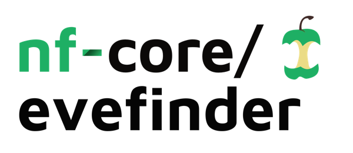

<h1>
  <picture>
    <source media="(prefers-color-scheme: dark)" srcset="docs/images/nf-core-evefinder_logo_dark.png">
    
  </picture>
</h1>

[](https://github.com/codespaces/new/nf-core/evefinder)
[](https://github.com/nf-core/evefinder/actions/workflows/nf-test.yml)
[](https://github.com/nf-core/evefinder/actions/workflows/linting.yml)[](https://nf-co.re/evefinder/results)[](https://doi.org/10.5281/zenodo.XXXXXXX)
[](https://www.nf-test.com)

[](https://www.nextflow.io/)
[](https://github.com/nf-core/tools/releases/tag/4.1.0)
[](https://docs.conda.io/en/latest/)
[](https://www.docker.com/)
[](https://sylabs.io/docs/)
[](https://cloud.seqera.io/launch?pipeline=https://github.com/nf-core/evefinder)

[](https://nfcore.slack.com/channels/evefinder)[](https://bsky.app/profile/nf-co.re)[](https://mstdn.science/@nf_core)[](https://www.youtube.com/c/nf-core)

## Introduction

**nf-core/evefinder** finds Endogenous Viral Elements (EVEs) in eukaryotic genomes with [EEfinder](https://github.com/WallauBioinfo/EEfinder), running every `eefinder screening` stage as its own process, one genome at a time.

The pipeline has three steps (`--step`):

1. `prepare_inputs`: downloads each genome (NCBI Datasets API, FASTA + GFF3, or ENA browser API, FASTA), the host protein baits (`eefinder get-databases host`, taxon taken from the genome) and, optionally, the viral protein database (`eefinder get-databases virus`), both indexed for `--search_mode`, and writes the samplesheet for `screening`.
2. `screening`: validates each database/metadata/baits set (`eefinder screening prepare`, which reuses the indexes beside the FASTAs and builds the missing ones), then runs `eefinder screening clean → align → filter → taxonomy → merge → postprocess → flanks` per genome, publishing `PREFIX.EEs.{fa,tax.tsv,gff3,faa,flanks.fa}` (the GFF3 with the CDS of each element, and their proteins), and clusters each genome's elements (cd-hit-est or vclust).
3. `analysis`: reads a finished screening and builds the genome phylogeny (mashtree) and the plots: an interactive HTML of the tree beside the elements per genome and taxon, and a Krona chart and a swarm plot per genome.

## Usage

> [!NOTE]
> If you are new to Nextflow and nf-core, please refer to [this page](https://nf-co.re/docs/get_started/environment_setup/overview) on how to set-up Nextflow. Make sure to [test your setup](https://nf-co.re/docs/get_started/run-your-first-pipeline) with `-profile test` before running the workflow on actual data.

First, list the genomes (`virus_taxid` is optional: one viral database is downloaded per distinct value, and rows without one use EEfinder's default, 10239):

```csv
accession,virus_taxid
GCA_021653915.1,11050
GCF_000146045.2,
```

```yaml title="prepare.yml"
step: prepare_inputs
input: genomes.csv
download_virus_db: true
virus_db_release_date: "2026-01-01"
outdir: results
```

```bash
nextflow run nf-core/evefinder -profile docker -params-file prepare.yml
```

Set `virus_db_fasta`/`virus_db_metadata` instead of `download_virus_db` to use a local database, and `genome_source: ena` to download from ENA. Boolean and integer parameters go in the `-params-file`: from Nextflow 26.04 on, command-line parameters always arrive as strings, so they fail validation (`--download_virus_db true`, `--min_length 1000`). Then screen the genomes with the samplesheet it wrote:

```bash
nextflow run nf-core/evefinder -profile docker \
   --step screening \
   --input <OUTDIR>/prepare_inputs/samplesheet.csv \
   --outdir <OUTDIR>
```

Then analyse the screening, with the same samplesheet:

```bash
nextflow run nf-core/evefinder -profile docker \
   --step analysis \
   --input <OUTDIR>/prepare_inputs/samplesheet.csv \
   --screening_outdir <OUTDIR> \
   --outdir <OUTDIR>
```

The `screening` samplesheet has the columns `sample,taxid,genome,baits,db_fasta,db_metadata`, so it can also be written by hand. Every `eefinder get-databases` and `eefinder screening` option is a pipeline parameter (see `nextflow_schema.json`).

> [!WARNING]
> Please provide pipeline parameters via the CLI or Nextflow `-params-file` option. Custom config files including those provided by the `-c` Nextflow option can be used to provide any configuration _**except for parameters**_; see [docs](https://nf-co.re/docs/running/run-pipelines#using-parameter-files).

### Running on a single machine

The `local` profile (`conf/local.config`) caps what tasks may request at what one machine has (16 CPUs, 18 GB, 48 h; edit it to match yours). Without it, the `process_high` label asks for 72 GB and the run stops on a laptop. Combine it with a container engine:

**Docker** (macOS, Linux):

```bash
nextflow run nf-core/evefinder -profile local,docker -params-file prepare.yml
nextflow run nf-core/evefinder -profile local,docker --step screening --input results/prepare_inputs/samplesheet.csv --outdir results
```

- On macOS the tasks run inside a Linux VM (Docker Desktop or Colima), so the VM's limits are what counts: `conf/local.config` follows them, not the Mac's. Raise them in Docker Desktop's Settings > Resources, or with `colima stop && colima start --cpu 16 --memory 20`, then edit `conf/local.config` to match.
- The EEfinder image (`dezordi/eefinder:2.0.0-dev`, pinned by digest) is `linux/amd64` only; on Apple Silicon it runs through emulation (Rosetta), with a platform warning in the task logs.
- The VM only mounts shared folders (`/Users` in Docker Desktop, your home directory in Colima by default): launch from, and write `--outdir`/`-work-dir` to, a path under one of them, not `/tmp`.

**Singularity / Apptainer** (Linux, HPC):

```bash
nextflow run nf-core/evefinder -profile local,singularity -params-file prepare.yml
nextflow run nf-core/evefinder -profile local,apptainer --step screening --input results/prepare_inputs/samplesheet.csv --outdir results
```

- The images are pulled from Docker Hub/quay.io and converted on first use; set `NXF_SINGULARITY_CACHEDIR` (or `NXF_APPTAINER_CACHEDIR`) to reuse them across runs.
- On a cluster, drop `local` and use your institution's profile (`-profile <institute>,singularity`), which sets the scheduler and its limits.

Check the setup with the test profile first (`-profile test,local,docker`): it screens an _Aedes aegypti_ contig, whose outputs match EEfinder's own golden files, and two genomes without elements. `-profile test_analysis,local,docker` on the same `--outdir` then builds the tree of the three genomes and the plots.

For more details and further functionality, please refer to the [usage documentation](https://nf-co.re/evefinder/usage) and the [parameter documentation](https://nf-co.re/evefinder/parameters).

## Pipeline output

To see the results of an example test run with a full size dataset refer to the [results](https://nf-co.re/evefinder/results) tab on the nf-core website pipeline page.
For more details about the output files and reports, please refer to the
[output documentation](https://nf-co.re/evefinder/output).

## Credits

nf-core/evefinder was originally written by [Filipe Dezordi](https://orcid.org/0000-0003-3259-3456) and [Yago José Mariz Dias](https://orcid.org/0000-0002-0786-6435).

## Contributions and Support

If you would like to contribute to this pipeline, please see the [contributing guidelines](docs/CONTRIBUTING.md).

For further information or help, don't hesitate to get in touch on the [Slack `#evefinder` channel](https://nfcore.slack.com/channels/evefinder) (you can join with [this invite](https://nf-co.re/join/slack)).

## Citations

<!-- TODO nf-core: Add citation for pipeline after first release. Uncomment lines below and update Zenodo doi and badge at the top of this file. -->
<!-- If you use nf-core/evefinder for your analysis, please cite it using the following doi: [10.5281/zenodo.XXXXXX](https://doi.org/10.5281/zenodo.XXXXXX) -->

<!-- TODO nf-core: Add bibliography of tools and data used in your pipeline -->

An extensive list of references for the tools used by the pipeline can be found in the [`CITATIONS.md`](CITATIONS.md) file.

You can cite the `nf-core` publication as follows:

> **The nf-core framework for community-curated bioinformatics pipelines.**
>
> Philip Ewels, Alexander Peltzer, Sven Fillinger, Harshil Patel, Johannes Alneberg, Andreas Wilm, Maxime Ulysse Garcia, Paolo Di Tommaso & Sven Nahnsen.
>
> _Nat Biotechnol._ 2020 Feb 13. doi: [10.1038/s41587-020-0439-x](https://dx.doi.org/10.1038/s41587-020-0439-x).
